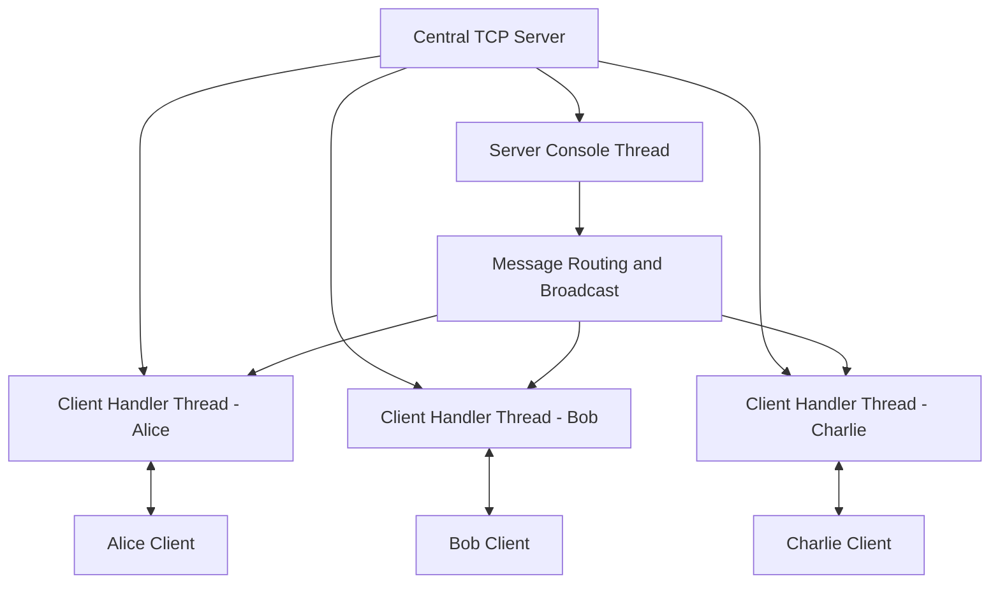
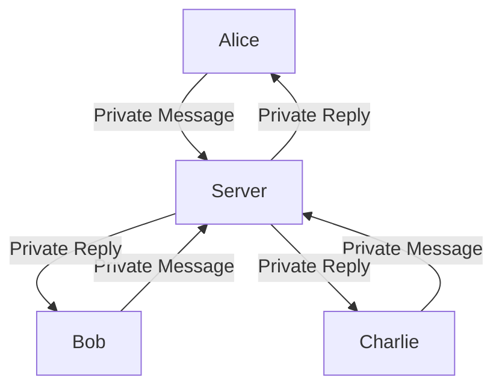
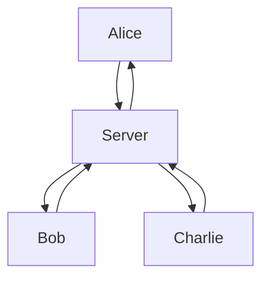
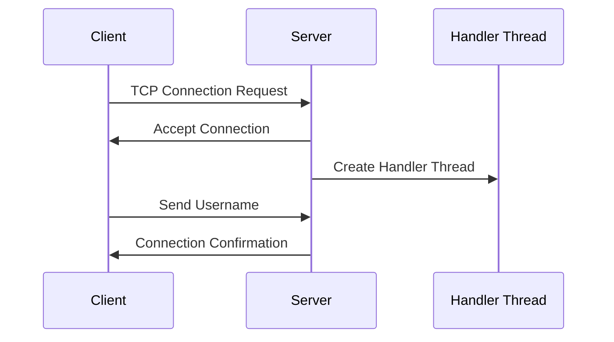
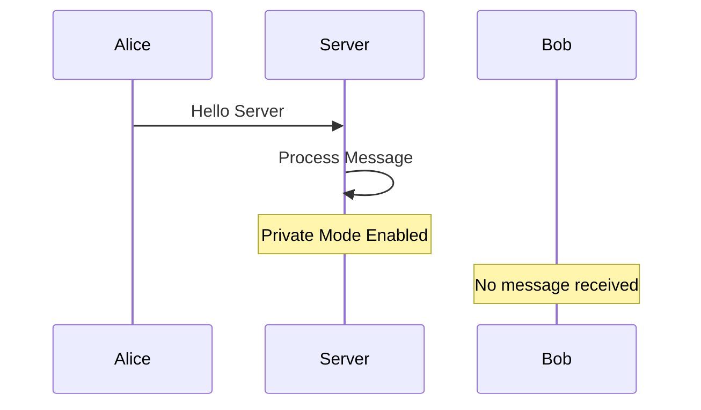
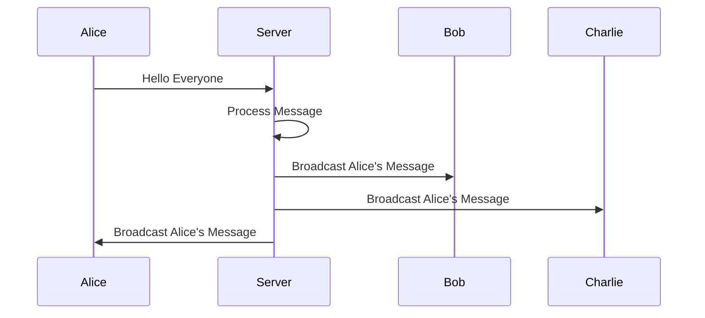
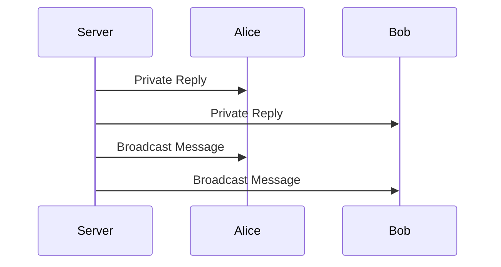

# 🖧 Multi-Client TCP Communication System

<p align="center">

**A multithreaded TCP client-server communication system with private messaging, dynamic broadcast mode, and server-controlled message routing.**

</p>

<p align="center">


</p>

---

## 📌 Overview

This project implements a multithreaded TCP communication system using Python's socket programming and threading modules.

A single server can accept multiple client connections simultaneously. The server controls how messages are routed using two communication modes:

- **Private Mode:** Client messages are received by the server but are not forwarded to other clients.
- **Broadcast Mode:** Client messages are forwarded to all connected clients when broadcast mode is enabled.

The server operator can dynamically switch between these modes without restarting the server. The server can also send private messages to individual clients or broadcast messages to all connected clients.

The project demonstrates fundamental distributed systems concepts, including TCP communication, concurrency, thread synchronization, message routing, and full-duplex communication.

---

## 🏗️ System Architecture

The system follows a centralized client-server architecture.

Multiple clients establish TCP connections with a single server. The server maintains a collection of connected clients and creates a dedicated handler thread for every client connection.

The server also maintains an independent console thread, allowing the operator to send commands and messages while client connections are being processed.

### Architecture Diagram



### Architecture Components

| Component | Responsibility |
|---|---|
| Central Server | Accepts TCP connections and manages communication |
| Client Handler Thread | Processes messages from an individual client |
| Server Console Thread | Allows the server operator to interact with connected clients |
| Client Socket | Establishes TCP communication with the server |
| Broadcast Function | Distributes messages to connected clients |
| Client Registry | Maintains connected client sockets and their names |
| Synchronization Locks | Protect shared data structures and communication mode |

---

## 🔄 Communication Modes

The server supports two dynamically configurable communication modes.

### 1. Private Mode

Private Mode is the default mode when the server starts.

In this mode:

- Clients can send messages to the server.
- The server operator can see incoming client messages.
- Messages are not automatically forwarded to other clients.
- The server can privately respond to individual clients.
- The server can still manually broadcast messages.



**Example:**

Alice sends:

```text
Hello Server
```

The server terminal displays:

```text
[PRIVATE MESSAGE] Alice: Hello Server
```

Bob and Charlie do not receive Alice's message.

### 2. Broadcast Mode

When Broadcast Mode is enabled, client messages are automatically forwarded to all connected clients.



**Example:**

Alice sends:

```text
Hello everyone!
```

All connected clients receive:

```text
[CHAT] Alice: Hello everyone!
```

Broadcast Mode can be disabled at any time to return to Private Mode.

### Mode Comparison

| Feature | Private Mode | Broadcast Mode |
|---|---|---|
| Client messages received by server | Yes | Yes |
| Client messages forwarded automatically | No | Yes |
| Server private replies | Yes | Yes |
| Manual server broadcast | Yes | Yes |
| Dynamic switching | Yes | Yes |

---

## ⚙️ Technologies Used

| Technology | Purpose |
|---|---|
| Python | Programming language |
| `socket` | TCP network communication |
| `threading` | Concurrent client handling |
| `threading.Lock` | Synchronization of shared data |
| TCP / IPv4 | Transport and addressing |
| UTF-8 | Message encoding |
| Newline-delimited messages | Message framing |

---

## 📂 Project Structure

```text
DS_FullDuplex/
│
├── server.py
├── client.py
└── README.md
```

| File | Description |
|---|---|
| `server.py` | Server implementation, client handling, routing, commands and mode control |
| `client.py` | Client implementation with independent sending and receiving |
| `README.md` | Project documentation |

---

## 🚀 Installation and Execution

### Prerequisites

- Python 3.8 or above
- Terminal, Command Prompt or PowerShell

No external Python libraries are required.

### Step 1: Clone the Repository

```bash
git clone https://github.com/YOUR_USERNAME/YOUR_REPOSITORY.git
```

Navigate to the project directory:

```bash
cd DS_FullDuplex
```

### Step 2: Start the Server

Open the first terminal:

```bash
python server.py
```

Expected output:

```text
[SERVER] Listening on 127.0.0.1:5000
[SERVER] Initial mode: PRIVATE
```

### Step 3: Start Client 1

Open another terminal:

```bash
python client.py
```

Enter a username:

```text
Enter your name: Alice
Connected! Type messages. Type /quit to leave.
```

### Step 4: Start Additional Clients

Open additional terminals and run:

```bash
python client.py
```

Example:

```text
Enter your name: Bob
```

```text
Enter your name: Charlie
```

Each client establishes an independent TCP connection with the server.

---

## 🖥️ Server Commands

The server operator can control the system through the server terminal.

| Command | Description |
|---|---|
| `/mode` | Toggles between Private Mode and Broadcast Mode |
| `/list` | Displays currently connected clients |
| `/reply NAME MESSAGE` | Sends a private message to a specific client |
| `/broadcast MESSAGE` | Broadcasts a message to all connected clients |
| Any ordinary text | Broadcasts the message to all connected clients |

### Toggle Broadcast Mode

```text
SERVER> /mode
```

When enabled:

```text
[MODE] BROADCAST MODE ON
[MODE] Client messages will be visible to all clients.
```

To disable:

```text
SERVER> /mode
```

```text
[MODE] PRIVATE MODE ON
[MODE] Client messages are visible only to the server.
```

### List Connected Clients

```text
SERVER> /list
```

Example:

```text
[CLIENTS] ['Alice', 'Bob', 'Charlie']
```

### Send a Private Message

```text
SERVER> /reply Alice Hello Alice!
```

Only Alice receives:

```text
[SERVER PRIVATE]: Hello Alice!
```

### Broadcast a Message

```text
SERVER> /broadcast Attention everyone!
```

All connected clients receive:

```text
[SERVER BROADCAST]: Attention everyone!
```

The server can also broadcast by typing any ordinary message directly into the server terminal.

---

## 📨 Communication Workflow

### Client Connection Workflow



### Private Mode Workflow



### Broadcast Mode Workflow



### Server-Initiated Communication



---

## 🧠 Code Explanation

### 1. Creating a TCP Socket

```python
server = socket.socket(socket.AF_INET, socket.SOCK_STREAM)
```

This creates a TCP socket using IPv4.

| Parameter | Meaning |
|---|---|
| `AF_INET` | IPv4 addressing |
| `SOCK_STREAM` | TCP stream communication |

TCP provides reliable, connection-oriented communication between endpoints.

### 2. Binding and Listening

```python
server.bind((HOST, PORT))
server.listen()
```

- `bind()` associates the socket with a specific IP address and port.
- `listen()` enables the server to wait for incoming connection requests.

### 3. Accepting Connections

```python
conn, address = server.accept()
```

`accept()` blocks until a client connects.

It returns:

- `conn`: A new connected socket used to communicate with that client.
- `address`: The address of the connecting client.

The listening socket remains available to accept additional clients.

### 4. Creating a Thread for Every Client

```python
thread = threading.Thread(
    target=handle_client,
    args=(conn, address),
    daemon=True
)

thread.start()
```

A separate thread is created for each accepted client connection.

This allows the server to handle multiple clients concurrently without waiting for one client to finish before accepting another.

### 5. Maintaining Connected Clients

```python
clients = {}
clients_lock = threading.Lock()
```

The `clients` dictionary stores connected client sockets and associated usernames.

A lock protects the shared dictionary from conflicting concurrent modifications.

### 6. Message Routing

In Private Mode, incoming client messages are displayed by the server but are not automatically forwarded.

In Broadcast Mode, the server forwards the incoming message using the broadcast function.

```python
if current_mode:
    broadcast(f"[CHAT] {name}: {message}")
```

The server determines whether a message should be forwarded based on the current communication mode.

### 7. Broadcast Function

```python
def broadcast(message):
    with clients_lock:
        connections = list(clients.items())

    for conn, name in connections:
        send_message(conn, message)
```

The broadcast function sends a message to the connected client sockets.

The server uses this function for:

- Server announcements
- Manual broadcasts
- Broadcast Mode client messages

### 8. Server Console Thread

```python
console_thread = threading.Thread(
    target=server_console,
    daemon=True
)

console_thread.start()
```

The server console runs in an independent thread.

This allows the server operator to interact with the system while the main thread continues accepting connections.

### 9. Synchronization

The project uses locks to protect shared resources.

| Lock | Purpose |
|---|---|
| `clients_lock` | Protects the shared client dictionary |
| `mode_lock` | Protects the broadcast mode state |

Locks help prevent race conditions when multiple threads access or modify shared data.

---

## 🔬 Distributed Systems Concepts Demonstrated

| Concept | Implementation |
|---|---|
| Client-server architecture | Central server with multiple clients |
| TCP communication | Reliable connection-oriented sockets |
| Concurrency | Multiple clients handled simultaneously |
| Multithreading | Thread-per-client architecture |
| Full-duplex communication | Independent client sending and receiving |
| Shared state | Client registry and broadcast mode |
| Synchronization | Thread locks |
| Message routing | Private and broadcast communication |
| Broadcasting | Server-controlled distribution of messages |
| Dynamic configuration | Runtime communication mode switching |

---

## 🧪 Test Scenarios

| Test | Expected Result |
|---|---|
| Connect one client | Client connects successfully |
| Connect multiple clients | Server handles multiple connections |
| Send message in Private Mode | Server receives message; other clients do not receive it |
| Enable Broadcast Mode | Client messages are forwarded to connected clients |
| Disable Broadcast Mode | Client messages become private to server again |
| Private server reply | Only specified client receives message |
| Server broadcast | All connected clients receive message |
| Disconnect client | Server removes client connection |

---

## ⚠️ Limitations

This project is intended as an educational demonstration of socket programming and multithreaded communication.

- Communication is limited to clients connected to the same server.
- The implementation uses local IPv4 loopback by default.
- The server does not use authentication.
- Messages are not encrypted.
- Client usernames are not validated for uniqueness.
- The system does not persist messages.
- TCP message framing is implemented using newline-delimited text.
- The implementation does not include advanced recovery, load balancing, or distributed server replication.

---

## 🔮 Future Improvements

- Client authentication
- Unique username validation
- Private messaging between clients
- Message timestamps
- GUI client interface
- Message history
- Encryption using TLS
- Server-side logging
- Heartbeat and connection monitoring
- Distributed server replication

---

## 📚 Learning Outcomes

After completing this project, the following concepts can be understood and demonstrated:

- TCP socket communication in Python
- Client-server architecture
- Handling multiple client connections
- Thread-per-client architecture
- Full-duplex communication
- Synchronization of shared data
- Dynamic message-routing strategies
- Private and broadcast communication
- Runtime configuration of a server

---

## 👨‍💻 Author

**CHETAN KUMAR G**

Distributed Systems Lab Project

---

<p align="center">

Built to explore TCP communication, concurrency, multithreading and distributed systems fundamentals.

</p>
